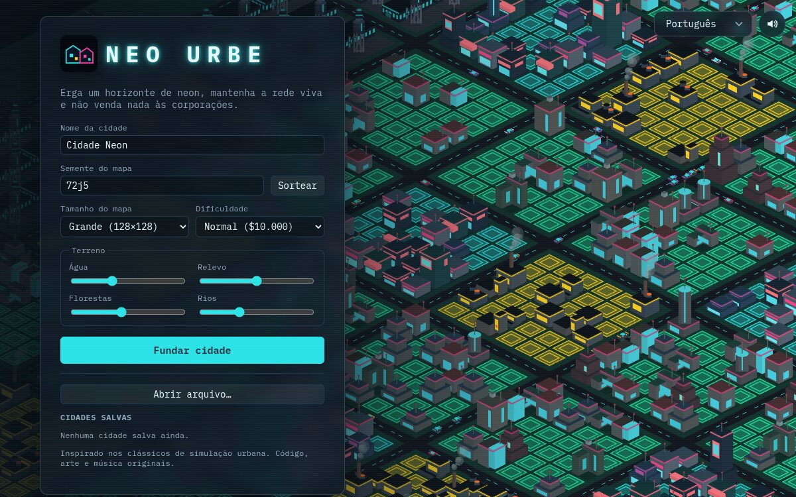
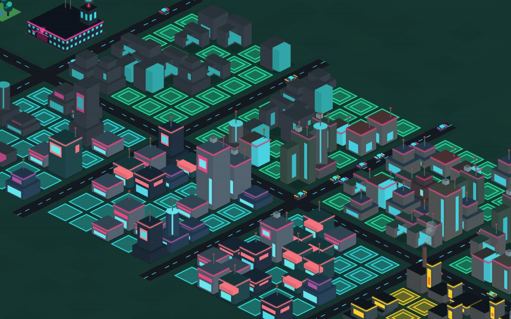
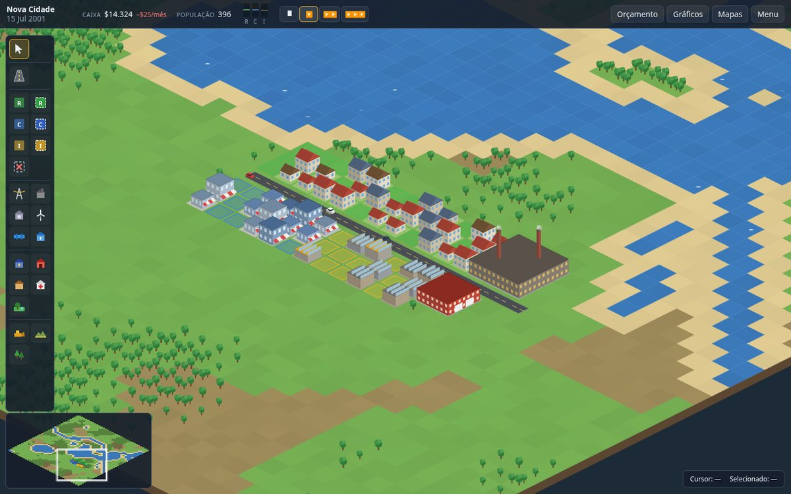
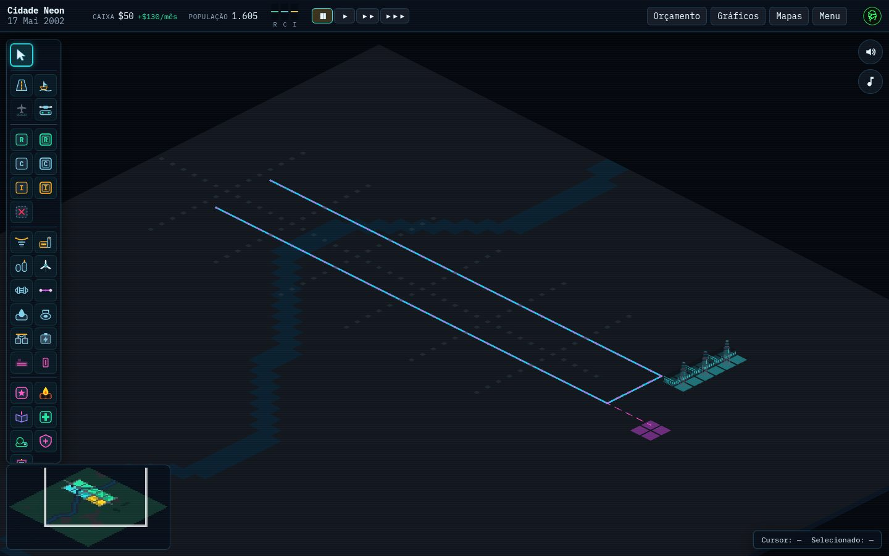
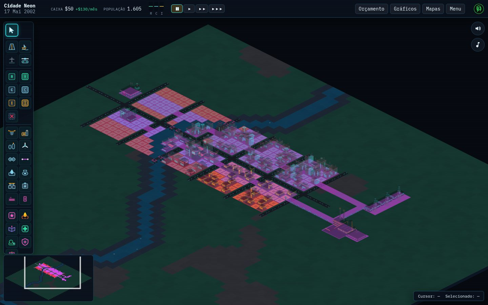
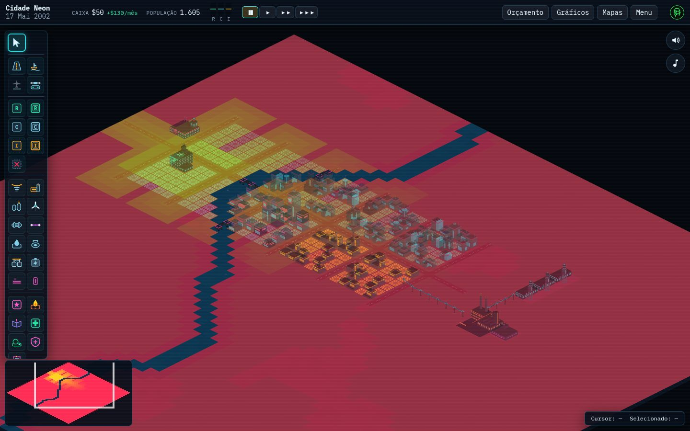
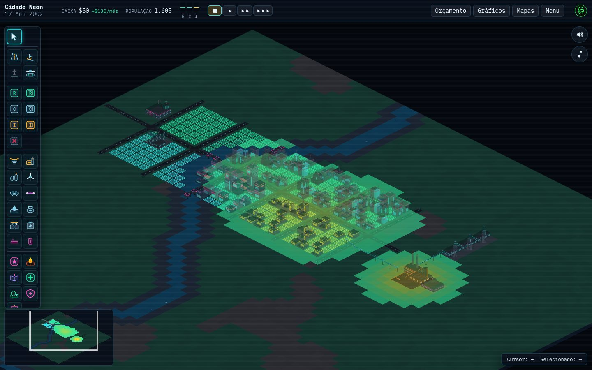

<p align="center">
  
</p>

<h1 align="center">Neo Urbe</h1>

<p align="center"><strong>Raise a neon skyline. Keep the grid alive.</strong></p>

<p align="center">
  <a href="https://gamestudio42.github.io/neo-urbe/"></a>
  <a href="https://github.com/gamestudio42/neo-urbe/stargazers"></a>
  <a href="https://github.com/gamestudio42/neo-urbe/fork"></a>
  <a href="https://github.com/gamestudio42"></a>
</p>

<p align="center">
  A cyberpunk isometric city builder that runs in the browser.
  Zone the land, hold an unstable power grid, keep the megacorps out —
  then watch demand, traffic and disasters do the rest.
  No install. Interface in English, Portuguese, Spanish, French and German.
</p>

<p align="center">
  <a href="https://gamestudio42.github.io/neo-urbe/">
    
  </a>
</p>

<p align="center">
  <a href="https://gamestudio42.github.io/neo-urbe/">
    
  </a>
</p>

## Screenshots

<p align="center">
  
</p>

<p align="center">
  
</p>

<p align="center">
  <a href="https://gamestudio42.github.io/neo-urbe/">
    
  </a>
</p>

## The maps

<table>
<tr>
<td align="center" width="50%" valign="top">
<br>
Water pipes, pumps and the fiber cable share the underground view.
</td>
<td align="center" width="50%" valign="top">
<br>
The data map grows along fiber and buildings from the supplying datacenter.
</td>
</tr>
<tr>
<td align="center" width="50%" valign="top">
<br>
Health coverage around the hospital.
</td>
<td align="center" width="50%" valign="top">
<br>
Pollution around industry and the power plant.
</td>
</tr>
</table>

## Why Neo Urbe

- **Play in the browser.** Open the link and found a city. Nothing to download.
- **You create the conditions.** Roads, zones, plants and fiber. The simulator grows — or abandons — the lots.
- **A city with extra pressure.** The grid overloads, corporations buy lots, hackers probe the network, drones follow the avenues and spires climb past the old skyline.
- **A living city.** Cars follow traffic, chimneys smoke, boats leave the marina, drones fly the streets.
- **A mayor's desk.** Taxes, department funding, charts, thematic maps and a tile inspector that tells you _why_ a lot is not growing.
- **Original soundtrack.** Synthwave, synthesized on the fly — one piece in the menu, another in the city.
- **Your city stays with you.** Autosave in the browser, plus export and import of `.neon.json` files.

## Play

|               |                                                                             |
| ------------- | --------------------------------------------------------------------------- |
| **Live game** | [gamestudio42.github.io/neo-urbe](https://gamestudio42.github.io/neo-urbe/) |
| **Hotkeys**   | `R` road · `1–6` zones · `E` power · `T` water · `P` pause · `M` sound      |
| **Language**  | English, Portuguese, Spanish, French, German · code and docs in English     |

## Develop

```sh
pnpm install
pnpm dev        # http://localhost:5178
```

Or with Docker: `docker compose up`.

| Command         | Description                                                 |
| --------------- | ----------------------------------------------------------- |
| `pnpm check`    | Lint, type check, unit/integration/scenario tests and build |
| `pnpm test:e2e` | Playwright end-to-end tests                                 |
| `pnpm sim`      | Headless simulation over presets and seeds                  |
| `pnpm bench`    | Tick timing benchmark (`--strict` for CI)                   |

Every push to `main` publishes `apps/neon/dist` to GitHub Pages. To host it elsewhere:

```sh
BASE_PATH=/path/ pnpm build
```

Docs: [architecture](docs/architecture.md) · [neon spec](docs/neon-spec.md) · [simulation spec](docs/simulation-spec.md) · [balancing](docs/balancing.md) · [mechanics](docs/mechanics-matrix.md) · [roadmap](docs/roadmap.md) · [testing](docs/testing-strategy.md) · [agents](AGENTS.md) · [contributing](CONTRIBUTING.md)

## Fork & remix

Neo Urbe is MIT-licensed. Fork it, change the rules, ship your own city on GitHub Pages.

```sh
git clone https://github.com/gamestudio42/neo-urbe.git
cd neo-urbe
pnpm install
pnpm dev
```

Enable Pages on your fork (the workflow in `.github/workflows/deploy.yml` already
publishes `apps/neon/dist`). Or host the build anywhere:

```sh
BASE_PATH=/your-path/ pnpm build
```

Ideas and patches: [good first issues](https://github.com/gamestudio42/neo-urbe/labels/good%20first%20issue).

## Licence

Original code, procedural sprites and synthesized sound and music, MIT licence.
Micropolis (GPLv3) and OpenSC2K were studied as references for behaviour only;
no code or assets were copied.
